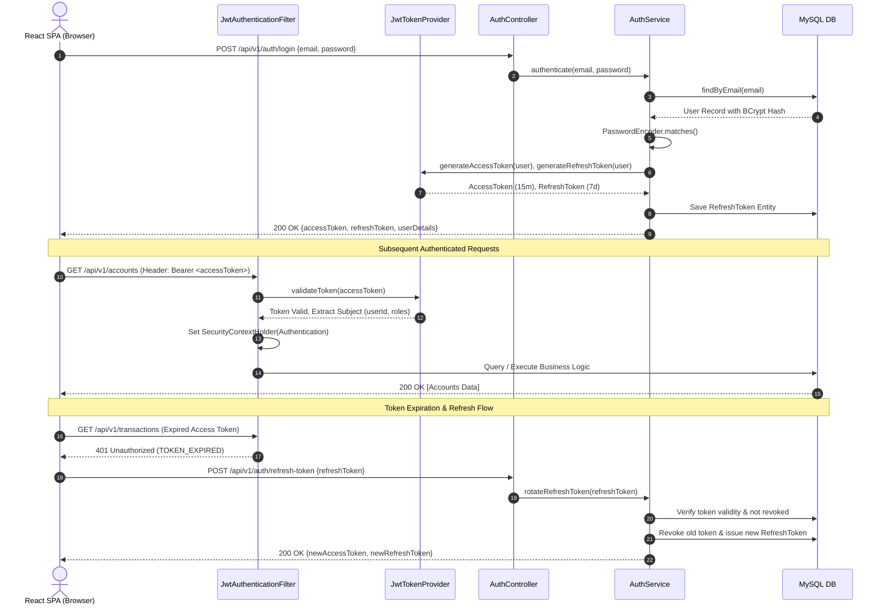
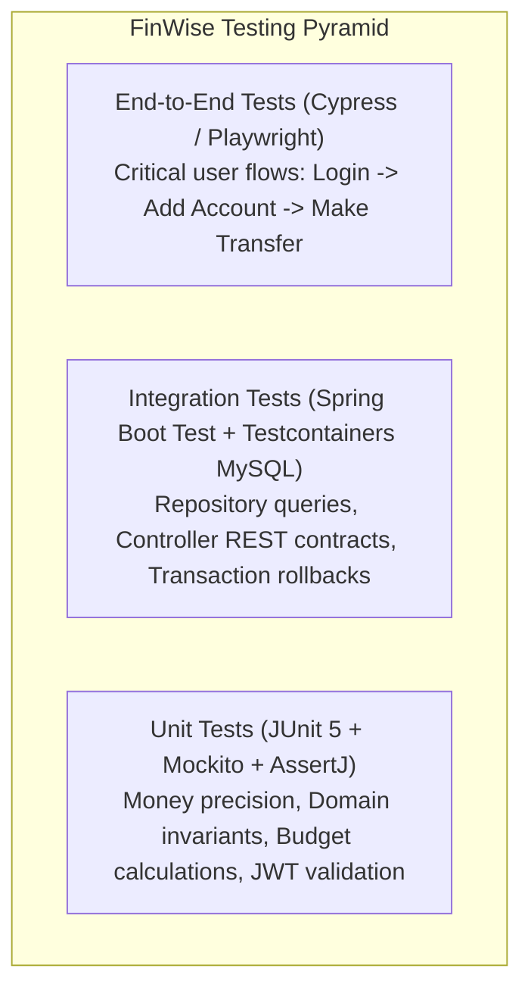

# FinWise - Smart Personal Finance Manager
## Comprehensive System Architecture Specification

---

### 1. Executive Architectural Blueprint

FinWise is engineered around modern cloud-native architectural patterns, strictly separating presentation, business orchestration, domain invariants, and persistence infrastructure.

#### 1.1. High-Level Container Diagram (C4 Model)

```mermaid
graph TD
    User["End User (Web Browser)"]

    subgraph Frontend["Frontend Tier (Client Browser / Nginx)"]
        SPA["React 18 SPA (Vite + Tailwind CSS + Recharts)"]
    end

    subgraph Gateway["Reverse Proxy / Web Server"]
        Nginx["Nginx Reverse Proxy (SSL, Compression, Static Serving)"]
    end

    subgraph Backend["Application Tier (Spring Boot 3.3 / Java 21)"]
        SecFilter["Spring Security Filter Chain (JWT Validator)"]
        API["REST Controllers (/api/v1/*)"]
        AppService["Application & Orchestration Services"]
        DomainCore["Domain Models & Financial Calculation Engine"]
        Scheduler["Async & Cron Task Engine (Project Loom Virtual Threads)"]
        Repo["Spring Data JPA Repositories"]
    end

    subgraph Database["Persistence Tier"]
        MySQL[("MySQL 8.0 InnoDB Database")]
    end

    User -->|HTTPS :443| Nginx
    Nginx -->|Static Assets| SPA
    Nginx -->|Proxy /api/v1/*| SecFilter
    SecFilter --> API
    API --> AppService
    AppService --> DomainCore
    AppService --> Repo
    Scheduler --> AppService
    Repo -->|JDBC Connection Pool (HikariCP)| MySQL
```

---

### 2. Backend Architecture (Java 21 / Spring Boot 3)

The backend follows the principles of **Clean Architecture** and **Domain-Driven Design (DDD)** packaged by feature/module for maximum modularity and maintainability.

```mermaid
graph LR
    subgraph Presentation["1. Presentation Layer"]
        C[REST Controllers]
        DTO[Request / Response DTOs]
        Advice[Global Exception Handlers]
    end

    subgraph Application["2. Application Service Layer"]
        S[Use Case Services]
        TX[Transaction Boundaries]
        Events[Domain Event Publishers]
    end

    subgraph Domain["3. Domain Core Layer"]
        E[Entities & Aggregates]
        VO[Value Objects (Money, Currency)]
        Rules[Business Invariants & Enums]
    end

    subgraph Infrastructure["4. Infrastructure Layer"]
        R[Spring Data Repositories]
        SEC[JWT Provider & Security Filters]
        EXT[Email / Push Notification Adapters]
    end

    C --> S
    S --> Domain
    S --> R
    R --> MySQL[MySQL Database]
    SEC -.-> Presentation
```

#### 2.1. Backend Package Structure

```
com.finwise
│
├── FinWiseApplication.java                  # Main Spring Boot entry point
│
├── common                                   # Shared kernel & cross-cutting utilities
│   ├── annotation                           # Custom annotations (e.g., @Idempotent, @CurrentUser)
│   ├── constants                            # System-wide constants & error code catalog
│   ├── dto                                  # Standard ApiResponse<T>, PageResponse<T>, ErrorResponse
│   ├── exception                            # Base domain exceptions (ResourceNotFound, BusinessException)
│   ├── model                                # Money value object, BaseEntity (created_at, updated_at, version)
│   └── util                                 # CurrencyFormatter (INR), DateUtils, SecurityContextHelper
│
├── config                                   # Spring configuration classes
│   ├── AsyncConfig.java                     # Virtual thread task executor configuration
│   ├── AuditConfig.java                     # Spring Data JPA Auditing & AuditorAware
│   ├── JacksonConfig.java                   # Custom serializers for BigDecimal (scale 2 string formatting)
│   ├── OpenApiConfig.java                   # Swagger / OpenAPI 3.0 documentation configuration
│   ├── SecurityConfig.java                  # Spring Security 6 filter chain, CORS & CSRF setup
│   └── WebMvcConfig.java                    # Interceptors, rate limiter filter registration
│
├── security                                 # Security implementation
│   ├── CustomUserDetailsService.java        # Loads UserDetails from database
│   ├── JwtAuthenticationEntryPoint.java     # Handles 401 Unauthorized responses (RFC 7807)
│   ├── JwtAccessDeniedHandler.java          # Handles 403 Forbidden responses
│   ├── JwtAuthenticationFilter.java        # Per-request JWT token validation filter
│   ├── JwtTokenProvider.java                # Token signing, parsing, claims extraction & validation
│   └── UserPrincipal.java                   # Authenticated principal implementing UserDetails
│
└── modules                                  # Modular feature domain packages
    ├── auth                                 # Authentication & Registration
    │   ├── controller                       # AuthController (login, register, refresh, logout)
    │   ├── dto                              # LoginRequest, RegisterRequest, AuthResponse, TokenRefreshRequest
    │   └── service                          # AuthService, RefreshTokenService
    │
    ├── user                                 # User account & settings
    │   ├── controller                       # UserController
    │   ├── dto                              # UserProfileResponse, UpdateUserRequest, PasswordChangeRequest
    │   ├── entity                           # User, Role
    │   ├── repository                       # UserRepository, RoleRepository
    │   └── service                          # UserService
    │
    ├── account                              # Financial Accounts (Savings, Credit Card, Wallets)
    │   ├── controller                       # AccountController
    │   ├── dto                              # AccountCreateRequest, AccountResponse, BalanceSummaryDto
    │   ├── entity                           # Account, AccountType (ENUM), AccountStatus (ENUM)
    │   ├── repository                       # AccountRepository
    │   └── service                          # AccountService, BalanceRecalculationService
    │
    ├── category                             # Category classification
    │   ├── controller                       # CategoryController
    │   ├── dto                              # CategoryDto, CategoryTreeResponse, CategoryCreateRequest
    │   ├── entity                           # Category, CategoryType (INCOME/EXPENSE)
    │   ├── repository                       # CategoryRepository
    │   └── service                          # CategoryService
    │
    ├── transaction                          # Core Ledger Transactions & Transfers
    │   ├── controller                       # TransactionController, TransferController
    │   ├── dto                              # TransactionCreateRequest, TransactionResponse, TransferRequest
    │   ├── entity                           # Transaction, Transfer, PaymentMode (ENUM), TransactionType
    │   ├── event                            # TransactionCreatedEvent, TransactionDeletedEvent
    │   ├── repository                       # TransactionRepository, TransferRepository
    │   ├── service                          # TransactionService, TransferService, TransactionExportService
    │   └── specification                    # TransactionSpecification (Dynamic criteria filtering)
    │
    ├── budget                               # Budgeting & Spending Controls
    │   ├── controller                       # BudgetController
    │   ├── dto                              # BudgetCreateRequest, BudgetResponse, BudgetProgressDto
    │   ├── entity                           # Budget, BudgetCategory
    │   ├── event                            # BudgetThresholdAlertListener (listens to TransactionCreated)
    │   ├── repository                       # BudgetRepository, BudgetCategoryRepository
    │   └── service                          # BudgetService, BudgetCalculationService
    │
    ├── goal                                 # Savings Goals
    │   ├── controller                       # GoalController
    │   ├── dto                              # GoalCreateRequest, GoalResponse, GoalContributionRequest
    │   ├── entity                           # Goal, GoalContribution, GoalStatus (ENUM)
    │   ├── repository                       # GoalRepository, GoalContributionRepository
    │   └── service                          # GoalService
    │
    ├── recurring                            # Subscriptions & Recurring Transaction Engine
    │   ├── controller                       # RecurringRuleController
    │   ├── dto                              # RecurringRuleRequest, RecurringRuleResponse
    │   ├── entity                           # RecurringRule, RecurrenceFrequency (ENUM)
    │   ├── repository                       # RecurringRuleRepository
    │   ├── scheduler                        # RecurringTransactionScheduler (Cron runner at 00:05 UTC)
    │   └── service                          # RecurringRuleService
    │
    ├── analytics                            # Reporting, Visualizations & Data Projections
    │   ├── controller                       # AnalyticsController
    │   ├── dto                              # CashFlowDto, CategoryExpenseDto, NetWorthTrendDto, DashboardSummaryDto
    │   └── service                          # AnalyticsService
    │
    └── audit                                # System & Compliance Audit Trail
        ├── entity                           # AuditLog, AuditAction (ENUM)
        ├── repository                       # AuditLogRepository
        └── service                          # AuditLogService
```

---

### 3. Financial Computation & Monetary Precision Engine

#### 3.1. Architectural Mandate: Zero Floating-Point Precision Loss
Financial software must never utilize IEEE 754 floating-point representations (`float` or `double`) due to binary fraction rounding discrepancies (e.g., `0.1 + 0.2 = 0.30000000000000004`).

#### 3.2. Value Object Specification: `Money`
```java
package com.finwise.common.model;

import com.fasterxml.jackson.annotation.JsonValue;
import jakarta.persistence.Embeddable;
import java.io.Serializable;
import java.math.BigDecimal;
import java.math.RoundingMode;
import java.text.NumberFormat;
import java.util.Locale;
import java.util.Objects;

@Embeddable
public final class Money implements Serializable, Comparable<Money> {

    public static final String DEFAULT_CURRENCY = "INR";
    public static final RoundingMode DEFAULT_ROUNDING = RoundingMode.HALF_EVEN; // Banker's Rounding
    public static final int STANDARD_SCALE = 2;

    private final BigDecimal amount;
    private final String currency;

    protected Money() {
        this.amount = BigDecimal.ZERO.setScale(STANDARD_SCALE, DEFAULT_ROUNDING);
        this.currency = DEFAULT_CURRENCY;
    }

    private Money(BigDecimal amount, String currency) {
        Objects.requireNonNull(amount, "Amount cannot be null");
        Objects.requireNonNull(currency, "Currency cannot be null");
        this.amount = amount.setScale(STANDARD_SCALE, DEFAULT_ROUNDING);
        this.currency = currency;
    }

    public static Money of(BigDecimal amount) {
        return new Money(amount, DEFAULT_CURRENCY);
    }

    public static Money of(String amountStr) {
        return new Money(new BigDecimal(amountStr), DEFAULT_CURRENCY);
    }

    public static Money zero() {
        return new Money(BigDecimal.ZERO, DEFAULT_CURRENCY);
    }

    public Money add(Money other) {
        assertSameCurrency(other);
        return new Money(this.amount.add(other.amount), this.currency);
    }

    public Money subtract(Money other) {
        assertSameCurrency(other);
        return new Money(this.amount.subtract(other.amount), this.currency);
    }

    public Money multiply(BigDecimal factor) {
        return new Money(this.amount.multiply(factor), this.currency);
    }

    public boolean isPositive() {
        return this.amount.compareTo(BigDecimal.ZERO) > 0;
    }

    public boolean isNegative() {
        return this.amount.compareTo(BigDecimal.ZERO) < 0;
    }

    public boolean isGreaterThanOrEqual(Money other) {
        assertSameCurrency(other);
        return this.amount.compareTo(other.amount) >= 0;
    }

    @JsonValue
    public BigDecimal getAmount() {
        return amount;
    }

    public String getCurrency() {
        return currency;
    }

    /**
     * Formats according to Indian Numbering System (e.g. ₹12,34,567.89)
     */
    public String toFormattedString() {
        NumberFormat inrFormat = NumberFormat.getCurrencyInstance(new Locale("en", "IN"));
        return inrFormat.format(this.amount);
    }

    private void assertSameCurrency(Money other) {
        if (!this.currency.equalsIgnoreCase(other.currency)) {
            throw new IllegalArgumentException("Currency mismatch: " + this.currency + " vs " + other.currency);
        }
    }

    @Override
    public int compareTo(Money o) {
        assertSameCurrency(o);
        return this.amount.compareTo(o.amount);
    }
}
```

---

### 4. Security Architecture & JWT Lifecycle

#### 4.1. Stateless Token Authentication Workflow



#### 4.2. Security Rules & RBAC Permissions
* **Role Hierarchy**:
  * `ROLE_ADMIN`: Platform metrics, user audits, system category provisioning, health diagnostics.
  * `ROLE_USER`: Standard tenant managing own accounts, transactions, budgets, goals.
* **Strict Tenant Data Isolation**:
  * Every repository query for non-admin requests must scope by `user_id`. Controllers retrieve authenticated `UserPrincipal` via `@AuthenticationPrincipal` and inject `user.getId()` into all service calls.
* **Password Policy**:
  * Minimum 10 characters, at least 1 uppercase letter, 1 lowercase letter, 1 number, and 1 special symbol. Encoded via `BCryptPasswordEncoder(strength = 12)`.

---

### 5. Concurrency Control & Transaction Isolation

1. **Transactional Boundaries**:
   * All mutations use `@Transactional(isolation = Isolation.READ_COMMITTED, rollbackFor = Exception.class)`.
2. **Account Balance Race Condition Mitigation**:
   * `Account` entity contains `@Version private Long version;`.
   * When two concurrent transactions attempt to debit an account, Hibernate evaluates:
     `UPDATE accounts SET current_balance = ?, version = version + 1 WHERE id = ? AND version = ?;`
   * If the version was modified by another thread, `OptimisticLockException` is thrown and caught by an exponential backoff retry interceptor (`@Retryable`).
3. **Double-Entry Transfer Guarantee**:
   * A fund transfer between two accounts is atomic:
     * Account A balance debited.
     * Transaction record for Debit created.
     * Account B balance credited.
     * Transaction record for Credit created.
     * Transfer linkage record created.
   * If any step fails, the entire transaction rolls back cleanly.

---

### 6. Frontend Architecture (React.js + Tailwind + Recharts)

#### 6.1. Frontend Directory Structure

```
finwise-frontend
│
├── index.html                               # HTML Entry
├── package.json                             # Dependencies & Scripts
├── tailwind.config.js                       # Tailwind custom colors (INR emeralds, slates)
├── vite.config.js                           # Vite build & proxy configuration
│
└── src
    ├── assets                               # Static logos, illustrations
    │
    ├── components                           # Reusable UI component library
    │   ├── common                           # Buttons, Modals, Badges, Tooltips, Loaders, Toasts
    │   ├── layout                           # AppLayout, Sidebar, Navbar, PageHeader, Footer
    │   ├── forms                            # FormInput, SelectField, CurrencyInput, DatePicker
    │   └── charts                           # Recharts wrappers
    │       ├── CashFlowBarChart.jsx         # Monthly income vs expense bars
    │       ├── CategoryDonutChart.jsx       # Spend breakdown by category
    │       ├── NetWorthAreaChart.jsx        # Net worth timeline
    │       └── BudgetProgressBar.jsx        # Gauge / progress meter with color alerts
    │
    ├── context                              # React Context (AuthContext, ThemeContext)
    │
    ├── hooks                                # Custom React hooks
    │   ├── useAuth.js                       # Login, register, logout, current user state
    │   ├── useAccounts.js                   # TanStack Query hook for accounts
    │   ├── useTransactions.js               # Paginated transactions with filter state
    │   ├── useBudgets.js                    # Active budget & threshold alerts
    │   └── useAnalytics.js                  # Analytics time-series queries
    │
    ├── pages                                # Application Views / Screens
    │   ├── auth                             # LoginPage, RegisterPage, ForgotPasswordPage
    │   ├── dashboard                        # Overview Dashboard (KPIs, Charts, Recent Activity)
    │   ├── accounts                         # AccountsList, AccountDetailModal, NewAccountModal
    │   ├── transactions                     # TransactionLedger, AddTransactionModal, ImportCSVModal
    │   ├── transfers                        # AccountTransferModal, TransferHistory
    │   ├── budgets                          # BudgetPlanner, CategoryAllocationView
    │   ├── goals                            # SavingsGoalsGrid, GoalContributeModal
    │   ├── recurring                        # SubscriptionsManager, RecurringRuleModal
    │   ├── analytics                        # In-depth Financial Reports & Export
    │   └── settings                         # UserProfile, SecuritySettings, CategorySettings
    │
    ├── services                             # API client communication layer
    │   ├── apiClient.js                     # Axios instance with JWT interceptors & token refresh
    │   ├── authService.js                   # Auth endpoints
    │   ├── accountService.js                # Account endpoints
    │   ├── transactionService.js            # Transaction endpoints
    │   ├── budgetService.js                 # Budget endpoints
    │   └── analyticsService.js              # Aggregation & report endpoints
    │
    ├── utils                                # Utility functions
    │   ├── currencyFormatter.js             # INR formatting (1,00,000.00 / ₹)
    │   ├── dateUtils.js                     # Date formatting (IST / ISO)
    │   └── validators.js                    # Client-side input validation rules
    │
    └── routes                               # Routing configuration
        ├── AppRoutes.jsx                    # Route mapping
        └── ProtectedRoute.jsx               # Guard checking auth state
```

#### 6.2. Indian Rupee (INR) Formatting Utility
```javascript
// src/utils/currencyFormatter.js

/**
 * Formats a numeric amount or string into Indian Rupee (INR) currency format.
 * Example: 154200.5 -> "₹1,54,200.50"
 */
export const formatINR = (amount, includeSymbol = true) => {
  if (amount === null || amount === undefined || isNaN(amount)) {
    return includeSymbol ? '₹0.00' : '0.00';
  }

  const numericValue = typeof amount === 'string' ? parseFloat(amount) : amount;

  const formatted = new Intl.NumberFormat('en-IN', {
    style: includeSymbol ? 'currency' : 'decimal',
    currency: 'INR',
    minimumFractionDigits: 2,
    maximumFractionDigits: 2,
  }).format(numericValue);

  return formatted;
};

/**
 * Formats compact numbers into Lakhs and Crores for high-level KPI cards
 * Example: 1500000 -> "₹15.00 Lakhs"
 */
export const formatCompactINR = (amount) => {
  const num = typeof amount === 'string' ? parseFloat(amount) : amount;
  if (Math.abs(num) >= 10000000) {
    return `₹${(num / 10000000).toFixed(2)} Cr`;
  }
  if (Math.abs(num) >= 100000) {
    return `₹${(num / 100000).toFixed(2)} L`;
  }
  return formatINR(amount);
};
```

---

### 7. Automated Testing Architecture & Quality Assurance



#### 7.1. Testing Matrix

| Test Type | Framework / Library | Target Area | Quality Gate |
| :--- | :--- | :--- | :--- |
| **Unit Testing** | JUnit 5, AssertJ, Mockito | Service business logic, Money class, JWT token parsing | 85%+ Code Coverage |
| **Slice Testing** | `@WebMvcTest`, Spring MockMvc | REST Controllers, DTO validations, HTTP status mapping | 100% Endpoint Coverage |
| **Integration Testing**| `@SpringBootTest`, Testcontainers | JPA Repositories, Database constraints, Optimistic locking | Zero DB dialect discrepancy |
| **Concurrency Testing**| `CountDownLatch`, `ExecutorService` | Multi-threaded balance updates, race-condition immunity | Zero balance drift |
| **Frontend Unit** | Vitest, React Testing Library | Component rendering, Form validations, Currency formatters | Core component coverage |
| **End-to-End (E2E)** | Playwright | Full user journey from signup to monthly budget review | Critical path validation |

---

### 8. Containerization & Production Deployment

#### 8.1. Multi-Stage Dockerfile for Spring Boot Backend
```dockerfile
# Stage 1: Build JAR using Maven and OpenJDK 21
FROM maven:3.9.6-eclipse-temurin-21-alpine AS build
WORKDIR /app
COPY pom.xml .
# Download dependencies for layer caching
RUN mvn dependency:go-offline -B
COPY src ./src
RUN mvn clean package -DskipTests -B

# Stage 2: Minimal Distroless / Alpine JRE Runtime
FROM eclipse-temurin:21-jre-alpine
WORKDIR /app
RUN addgroup -S finwise && adduser -S finwise -G finwise
USER finwise:finwise

COPY --from=build /app/target/finwise-backend-*.jar app.jar

ENV JAVA_OPTS="-XX:+UseZGC -XX:+ZGenerational -XX:MaxRAMPercentage=75.0"
EXPOSE 8080
ENTRYPOINT ["sh", "-c", "java $JAVA_OPTS -jar app.jar"]
```

#### 8.2. Multi-Stage Dockerfile for React SPA Frontend
```dockerfile
# Stage 1: Build React Assets with Vite
FROM node:20-alpine AS build
WORKDIR /app
COPY package*.json ./
RUN npm ci
COPY . .
RUN npm run build

# Stage 2: Production Nginx Server
FROM nginx:1.25-alpine
COPY --from=build /app/dist /usr/share/nginx/html
COPY nginx.conf /etc/nginx/conf.d/default.conf
EXPOSE 80
CMD ["nginx", "-g", "daemon off;"]
```

#### 8.3. Full-Stack Docker Compose Orchestration
```yaml
version: '3.8'

services:
  mysql-db:
    image: mysql:8.0.36
    container_name: finwise-mysql
    restart: always
    environment:
      MYSQL_DATABASE: finwise_db
      MYSQL_USER: finwise_user
      MYSQL_PASSWORD: FinWiseStrongPassword#2026
      MYSQL_ROOT_PASSWORD: RootPassword#2026
    ports:
      - "3306:3306"
    volumes:
      - mysql_data:/var/lib/mysql
    command: --character-set-server=utf8mb4 --collation-server=utf8mb4_unicode_ci --default-time-zone='+00:00'
    healthcheck:
      test: ["CMD", "mysqladmin", "ping", "-h", "localhost"]
      interval: 10s
      timeout: 5s
      retries: 5

  backend:
    build:
      context: ./backend
      dockerfile: Dockerfile
    container_name: finwise-backend
    restart: always
    depends_on:
      mysql-db:
        condition: service_healthy
    environment:
      SPRING_PROFILES_ACTIVE: prod
      SPRING_DATASOURCE_URL: jdbc:mysql://mysql-db:3306/finwise_db?useSSL=false&allowPublicKeyRetrieval=true&serverTimezone=UTC
      SPRING_DATASOURCE_USERNAME: finwise_user
      SPRING_DATASOURCE_PASSWORD: FinWiseStrongPassword#2026
      JWT_SECRET: c01f68747ca9fd4e98a7d4f826391d84a7e937b4f59c160b72183e9da5ef1010
      JWT_ACCESS_EXPIRATION_MS: 900000 # 15 minutes
      JWT_REFRESH_EXPIRATION_MS: 604800000 # 7 days
    ports:
      - "8080:8080"

  frontend:
    build:
      context: ./frontend
      dockerfile: Dockerfile
    container_name: finwise-frontend
    restart: always
    depends_on:
      - backend
    ports:
      - "80:80"

volumes:
  mysql_data:
    driver: local
```
