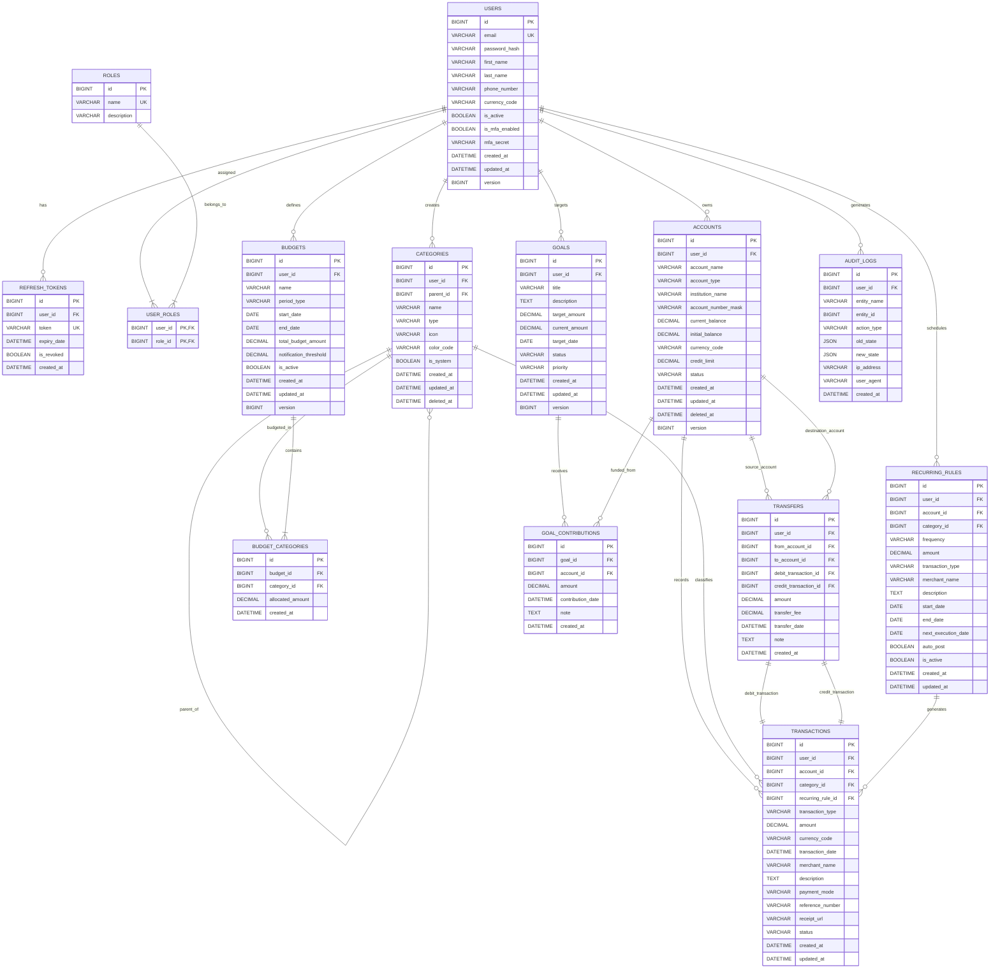

# FinWise - Smart Personal Finance Manager
## Database Architecture & Schema Design

---

### 1. Database Architectural Principles

1. **Monetary Precision & Integrity**:
   * All monetary figures are stored using `DECIMAL(15, 2)` (up to ₹9,99,99,99,99,99,999.99), ensuring zero floating-point rounding errors.
   * Exchange rates and fractional percentages (tax, split ratios) are stored as `DECIMAL(8, 4)`.
   * Floating-point data types (`FLOAT`, `DOUBLE`) are strictly forbidden across all tables.

2. **ACID Transactional Guarantees**:
   * Storage Engine: **InnoDB** across all tables for multi-version concurrency control (MVCC) and row-level locking.
   * Character Set & Collation: `utf8mb4` with `utf8mb4_unicode_ci` to support internationalization, notes, emojis, and multilingual merchant names.

3. **Referential Integrity & Financial Auditability**:
   * Foreign keys explicitly declare `ON DELETE RESTRICT` or `ON DELETE NO ACTION` for financial transactions and account records. Financial history must never be accidentally cascade-deleted.
   * `soft_deleted` flags (`deleted_at IS NULL`) are utilized on `accounts` and `categories` to maintain historical transaction integrity while hiding deactivated entities from UI selection.

4. **Temporal Precision**:
   * All timestamps use `DATETIME(6)` or `TIMESTAMP(6)` storing values in Coordinated Universal Time (UTC). Display conversion to Indian Standard Time (IST - UTC+05:30) is executed at the presentation layer.

5. **Optimistic Concurrency Control**:
   * High-concurrency mutable entities (`accounts`, `budgets`, `goals`) include a `version BIGINT NOT NULL DEFAULT 0` column mapped to Hibernate `@Version` to prevent lost updates during concurrent balance adjustments.

---

### 2. Entity-Relationship (ER) Diagram



---

### 3. Detailed Table Schema Definitions & DDL

#### 3.1. Authentication & Identity Management

```sql
-- 1. Roles Definition Table
CREATE TABLE roles (
    id BIGINT AUTO_INCREMENT PRIMARY KEY,
    name VARCHAR(50) NOT NULL UNIQUE,
    description VARCHAR(255) NULL,
    created_at DATETIME(6) NOT NULL DEFAULT CURRENT_TIMESTAMP(6)
) ENGINE=InnoDB DEFAULT CHARSET=utf8mb4 COLLATE=utf8mb4_unicode_ci;

-- 2. Users Table
CREATE TABLE users (
    id BIGINT AUTO_INCREMENT PRIMARY KEY,
    email VARCHAR(191) NOT NULL UNIQUE,
    password_hash VARCHAR(255) NOT NULL,
    first_name VARCHAR(100) NOT NULL,
    last_name VARCHAR(100) NOT NULL,
    phone_number VARCHAR(20) NULL,
    currency_code VARCHAR(3) NOT NULL DEFAULT 'INR',
    is_active BOOLEAN NOT NULL DEFAULT TRUE,
    is_mfa_enabled BOOLEAN NOT NULL DEFAULT FALSE,
    mfa_secret VARCHAR(100) NULL,
    created_at DATETIME(6) NOT NULL DEFAULT CURRENT_TIMESTAMP(6),
    updated_at DATETIME(6) NOT NULL DEFAULT CURRENT_TIMESTAMP(6) ON UPDATE CURRENT_TIMESTAMP(6),
    version BIGINT NOT NULL DEFAULT 0,
    CONSTRAINT chk_users_currency CHECK (CHAR_LENGTH(currency_code) = 3)
) ENGINE=InnoDB DEFAULT CHARSET=utf8mb4 COLLATE=utf8mb4_unicode_ci;

CREATE INDEX idx_users_email ON users(email);

-- 3. User Role Junction Table
CREATE TABLE user_roles (
    user_id BIGINT NOT NULL,
    role_id BIGINT NOT NULL,
    PRIMARY KEY (user_id, role_id),
    CONSTRAINT fk_user_roles_user FOREIGN KEY (user_id) REFERENCES users(id) ON DELETE CASCADE,
    CONSTRAINT fk_user_roles_role FOREIGN KEY (role_id) REFERENCES roles(id) ON DELETE RESTRICT
) ENGINE=InnoDB DEFAULT CHARSET=utf8mb4 COLLATE=utf8mb4_unicode_ci;

-- 4. Refresh Tokens Table (Rotating Refresh Tokens)
CREATE TABLE refresh_tokens (
    id BIGINT AUTO_INCREMENT PRIMARY KEY,
    user_id BIGINT NOT NULL,
    token VARCHAR(255) NOT NULL UNIQUE,
    expiry_date DATETIME(6) NOT NULL,
    is_revoked BOOLEAN NOT NULL DEFAULT FALSE,
    created_at DATETIME(6) NOT NULL DEFAULT CURRENT_TIMESTAMP(6),
    CONSTRAINT fk_refresh_token_user FOREIGN KEY (user_id) REFERENCES users(id) ON DELETE CASCADE
) ENGINE=InnoDB DEFAULT CHARSET=utf8mb4 COLLATE=utf8mb4_unicode_ci;

CREATE INDEX idx_refresh_token_lookup ON refresh_tokens(token, is_revoked);
```

#### 3.2. Financial Accounts

```sql
-- 5. Accounts Table (Bank, Credit Card, Wallet, Demat, Cash)
CREATE TABLE accounts (
    id BIGINT AUTO_INCREMENT PRIMARY KEY,
    user_id BIGINT NOT NULL,
    account_name VARCHAR(100) NOT NULL,
    account_type ENUM('SAVINGS', 'CURRENT', 'CREDIT_CARD', 'CASH', 'WALLET_UPI', 'INVESTMENT') NOT NULL,
    institution_name VARCHAR(100) NULL,
    account_number_mask VARCHAR(20) NULL,
    current_balance DECIMAL(15, 2) NOT NULL DEFAULT 0.00,
    initial_balance DECIMAL(15, 2) NOT NULL DEFAULT 0.00,
    currency_code VARCHAR(3) NOT NULL DEFAULT 'INR',
    credit_limit DECIMAL(15, 2) NULL DEFAULT 0.00,
    status ENUM('ACTIVE', 'DORMANT', 'CLOSED') NOT NULL DEFAULT 'ACTIVE',
    created_at DATETIME(6) NOT NULL DEFAULT CURRENT_TIMESTAMP(6),
    updated_at DATETIME(6) NOT NULL DEFAULT CURRENT_TIMESTAMP(6) ON UPDATE CURRENT_TIMESTAMP(6),
    deleted_at DATETIME(6) NULL,
    version BIGINT NOT NULL DEFAULT 0,
    CONSTRAINT fk_accounts_user FOREIGN KEY (user_id) REFERENCES users(id) ON DELETE RESTRICT,
    CONSTRAINT chk_accounts_currency CHECK (CHAR_LENGTH(currency_code) = 3)
) ENGINE=InnoDB DEFAULT CHARSET=utf8mb4 COLLATE=utf8mb4_unicode_ci;

CREATE INDEX idx_accounts_user_status ON accounts(user_id, status, deleted_at);
```

#### 3.3. Transaction Categorization

```sql
-- 6. Categories Table (Hierarchical: Parent -> Children)
CREATE TABLE categories (
    id BIGINT AUTO_INCREMENT PRIMARY KEY,
    user_id BIGINT NULL, -- NULL implies global default category created by system
    parent_id BIGINT NULL,
    name VARCHAR(100) NOT NULL,
    type ENUM('INCOME', 'EXPENSE') NOT NULL,
    icon VARCHAR(50) NOT NULL DEFAULT 'tag',
    color_code VARCHAR(7) NOT NULL DEFAULT '#4F46E5', -- Hex color code
    is_system BOOLEAN NOT NULL DEFAULT FALSE,
    created_at DATETIME(6) NOT NULL DEFAULT CURRENT_TIMESTAMP(6),
    updated_at DATETIME(6) NOT NULL DEFAULT CURRENT_TIMESTAMP(6) ON UPDATE CURRENT_TIMESTAMP(6),
    deleted_at DATETIME(6) NULL,
    CONSTRAINT fk_categories_user FOREIGN KEY (user_id) REFERENCES users(id) ON DELETE RESTRICT,
    CONSTRAINT fk_categories_parent FOREIGN KEY (parent_id) REFERENCES categories(id) ON DELETE RESTRICT,
    CONSTRAINT uq_user_category_name UNIQUE (user_id, name, type, deleted_at)
) ENGINE=InnoDB DEFAULT CHARSET=utf8mb4 COLLATE=utf8mb4_unicode_ci;

CREATE INDEX idx_categories_user_type ON categories(user_id, type, deleted_at);
```

#### 3.4. Transactions & Transfers (Ledger Core)

```sql
-- 7. Recurring Rules (Subscriptions, SIPs, Scheduled Payments)
CREATE TABLE recurring_rules (
    id BIGINT AUTO_INCREMENT PRIMARY KEY,
    user_id BIGINT NOT NULL,
    account_id BIGINT NOT NULL,
    category_id BIGINT NOT NULL,
    frequency ENUM('DAILY', 'WEEKLY', 'BI_WEEKLY', 'MONTHLY', 'QUARTERLY', 'YEARLY') NOT NULL,
    amount DECIMAL(15, 2) NOT NULL,
    transaction_type ENUM('INCOME', 'EXPENSE') NOT NULL,
    merchant_name VARCHAR(150) NULL,
    description VARCHAR(255) NULL,
    start_date DATE NOT NULL,
    end_date DATE NULL,
    next_execution_date DATE NOT NULL,
    auto_post BOOLEAN NOT NULL DEFAULT TRUE,
    is_active BOOLEAN NOT NULL DEFAULT TRUE,
    created_at DATETIME(6) NOT NULL DEFAULT CURRENT_TIMESTAMP(6),
    updated_at DATETIME(6) NOT NULL DEFAULT CURRENT_TIMESTAMP(6) ON UPDATE CURRENT_TIMESTAMP(6),
    CONSTRAINT fk_recurring_user FOREIGN KEY (user_id) REFERENCES users(id) ON DELETE RESTRICT,
    CONSTRAINT fk_recurring_account FOREIGN KEY (account_id) REFERENCES accounts(id) ON DELETE RESTRICT,
    CONSTRAINT fk_recurring_category FOREIGN KEY (category_id) REFERENCES categories(id) ON DELETE RESTRICT,
    CONSTRAINT chk_recurring_amount CHECK (amount > 0.00)
) ENGINE=InnoDB DEFAULT CHARSET=utf8mb4 COLLATE=utf8mb4_unicode_ci;

CREATE INDEX idx_recurring_cron ON recurring_rules(is_active, next_execution_date);

-- 8. Transactions Table
CREATE TABLE transactions (
    id BIGINT AUTO_INCREMENT PRIMARY KEY,
    user_id BIGINT NOT NULL,
    account_id BIGINT NOT NULL,
    category_id BIGINT NOT NULL,
    recurring_rule_id BIGINT NULL,
    transaction_type ENUM('INCOME', 'EXPENSE', 'TRANSFER_DEBIT', 'TRANSFER_CREDIT') NOT NULL,
    amount DECIMAL(15, 2) NOT NULL,
    currency_code VARCHAR(3) NOT NULL DEFAULT 'INR',
    transaction_date DATETIME(6) NOT NULL,
    merchant_name VARCHAR(150) NULL,
    description TEXT NULL,
    payment_mode ENUM('UPI', 'NET_BANKING', 'DEBIT_CARD', 'CREDIT_CARD', 'CASH', 'CHEQUE', 'NEFT_RTGS_IMPS') NOT NULL DEFAULT 'UPI',
    reference_number VARCHAR(100) NULL,
    receipt_url VARCHAR(500) NULL,
    status ENUM('COMPLETED', 'PENDING', 'CANCELLED') NOT NULL DEFAULT 'COMPLETED',
    created_at DATETIME(6) NOT NULL DEFAULT CURRENT_TIMESTAMP(6),
    updated_at DATETIME(6) NOT NULL DEFAULT CURRENT_TIMESTAMP(6) ON UPDATE CURRENT_TIMESTAMP(6),
    CONSTRAINT fk_transactions_user FOREIGN KEY (user_id) REFERENCES users(id) ON DELETE RESTRICT,
    CONSTRAINT fk_transactions_account FOREIGN KEY (account_id) REFERENCES accounts(id) ON DELETE RESTRICT,
    CONSTRAINT fk_transactions_category FOREIGN KEY (category_id) REFERENCES categories(id) ON DELETE RESTRICT,
    CONSTRAINT fk_transactions_recurring FOREIGN KEY (recurring_rule_id) REFERENCES recurring_rules(id) ON DELETE SET NULL,
    CONSTRAINT chk_transactions_amount CHECK (amount > 0.00)
) ENGINE=InnoDB DEFAULT CHARSET=utf8mb4 COLLATE=utf8mb4_unicode_ci;

-- Composite performance indexes for query optimization
CREATE INDEX idx_transactions_user_date ON transactions(user_id, transaction_date DESC);
CREATE INDEX idx_transactions_user_category ON transactions(user_id, category_id, transaction_date);
CREATE INDEX idx_transactions_account ON transactions(account_id, transaction_date DESC);
CREATE INDEX idx_transactions_ref ON transactions(reference_number);

-- 9. Account Transfers Table (Double-Entry Linkage)
CREATE TABLE transfers (
    id BIGINT AUTO_INCREMENT PRIMARY KEY,
    user_id BIGINT NOT NULL,
    from_account_id BIGINT NOT NULL,
    to_account_id BIGINT NOT NULL,
    debit_transaction_id BIGINT NOT NULL UNIQUE,
    credit_transaction_id BIGINT NOT NULL UNIQUE,
    amount DECIMAL(15, 2) NOT NULL,
    transfer_fee DECIMAL(15, 2) NOT NULL DEFAULT 0.00,
    transfer_date DATETIME(6) NOT NULL,
    note VARCHAR(255) NULL,
    created_at DATETIME(6) NOT NULL DEFAULT CURRENT_TIMESTAMP(6),
    CONSTRAINT fk_transfers_user FOREIGN KEY (user_id) REFERENCES users(id) ON DELETE RESTRICT,
    CONSTRAINT fk_transfers_from_account FOREIGN KEY (from_account_id) REFERENCES accounts(id) ON DELETE RESTRICT,
    CONSTRAINT fk_transfers_to_account FOREIGN KEY (to_account_id) REFERENCES accounts(id) ON DELETE RESTRICT,
    CONSTRAINT fk_transfers_debit_tx FOREIGN KEY (debit_transaction_id) REFERENCES transactions(id) ON DELETE RESTRICT,
    CONSTRAINT fk_transfers_credit_tx FOREIGN KEY (credit_transaction_id) REFERENCES transactions(id) ON DELETE RESTRICT,
    CONSTRAINT chk_transfers_distinct_accounts CHECK (from_account_id <> to_account_id),
    CONSTRAINT chk_transfers_amount CHECK (amount > 0.00)
) ENGINE=InnoDB DEFAULT CHARSET=utf8mb4 COLLATE=utf8mb4_unicode_ci;

CREATE INDEX idx_transfers_user_date ON transfers(user_id, transfer_date DESC);
```

#### 3.5. Budgets & Financial Planning

```sql
-- 10. Budgets Table
CREATE TABLE budgets (
    id BIGINT AUTO_INCREMENT PRIMARY KEY,
    user_id BIGINT NOT NULL,
    name VARCHAR(100) NOT NULL,
    period_type ENUM('MONTHLY', 'QUARTERLY', 'YEARLY', 'CUSTOM') NOT NULL DEFAULT 'MONTHLY',
    start_date DATE NOT NULL,
    end_date DATE NOT NULL,
    total_budget_amount DECIMAL(15, 2) NOT NULL,
    notification_threshold DECIMAL(5, 2) NOT NULL DEFAULT 80.00, -- e.g., 80% threshold warning
    is_active BOOLEAN NOT NULL DEFAULT TRUE,
    created_at DATETIME(6) NOT NULL DEFAULT CURRENT_TIMESTAMP(6),
    updated_at DATETIME(6) NOT NULL DEFAULT CURRENT_TIMESTAMP(6) ON UPDATE CURRENT_TIMESTAMP(6),
    version BIGINT NOT NULL DEFAULT 0,
    CONSTRAINT fk_budgets_user FOREIGN KEY (user_id) REFERENCES users(id) ON DELETE RESTRICT,
    CONSTRAINT chk_budgets_dates CHECK (end_date >= start_date),
    CONSTRAINT chk_budgets_total CHECK (total_budget_amount > 0.00),
    CONSTRAINT chk_budgets_threshold CHECK (notification_threshold > 0.00 AND notification_threshold <= 100.00)
) ENGINE=InnoDB DEFAULT CHARSET=utf8mb4 COLLATE=utf8mb4_unicode_ci;

CREATE INDEX idx_budgets_user_period ON budgets(user_id, start_date, end_date, is_active);

-- 11. Budget Categories Allocation Table
CREATE TABLE budget_categories (
    id BIGINT AUTO_INCREMENT PRIMARY KEY,
    budget_id BIGINT NOT NULL,
    category_id BIGINT NOT NULL,
    allocated_amount DECIMAL(15, 2) NOT NULL,
    created_at DATETIME(6) NOT NULL DEFAULT CURRENT_TIMESTAMP(6),
    CONSTRAINT fk_budget_categories_budget FOREIGN KEY (budget_id) REFERENCES budgets(id) ON DELETE CASCADE,
    CONSTRAINT fk_budget_categories_category FOREIGN KEY (category_id) REFERENCES categories(id) ON DELETE RESTRICT,
    CONSTRAINT uq_budget_category UNIQUE (budget_id, category_id),
    CONSTRAINT chk_budget_cat_amount CHECK (allocated_amount > 0.00)
) ENGINE=InnoDB DEFAULT CHARSET=utf8mb4 COLLATE=utf8mb4_unicode_ci;
```

#### 3.6. Savings Goals & Audit Trail

```sql
-- 12. Goals Table
CREATE TABLE goals (
    id BIGINT AUTO_INCREMENT PRIMARY KEY,
    user_id BIGINT NOT NULL,
    title VARCHAR(150) NOT NULL,
    description TEXT NULL,
    target_amount DECIMAL(15, 2) NOT NULL,
    current_amount DECIMAL(15, 2) NOT NULL DEFAULT 0.00,
    target_date DATE NOT NULL,
    status ENUM('IN_PROGRESS', 'COMPLETED', 'ABANDONED') NOT NULL DEFAULT 'IN_PROGRESS',
    priority ENUM('LOW', 'MEDIUM', 'HIGH') NOT NULL DEFAULT 'MEDIUM',
    created_at DATETIME(6) NOT NULL DEFAULT CURRENT_TIMESTAMP(6),
    updated_at DATETIME(6) NOT NULL DEFAULT CURRENT_TIMESTAMP(6) ON UPDATE CURRENT_TIMESTAMP(6),
    version BIGINT NOT NULL DEFAULT 0,
    CONSTRAINT fk_goals_user FOREIGN KEY (user_id) REFERENCES users(id) ON DELETE RESTRICT,
    CONSTRAINT chk_goals_target_amt CHECK (target_amount > 0.00),
    CONSTRAINT chk_goals_current_amt CHECK (current_amount >= 0.00)
) ENGINE=InnoDB DEFAULT CHARSET=utf8mb4 COLLATE=utf8mb4_unicode_ci;

CREATE INDEX idx_goals_user_status ON goals(user_id, status);

-- 13. Goal Contributions Table
CREATE TABLE goal_contributions (
    id BIGINT AUTO_INCREMENT PRIMARY KEY,
    goal_id BIGINT NOT NULL,
    account_id BIGINT NOT NULL,
    amount DECIMAL(15, 2) NOT NULL,
    contribution_date DATETIME(6) NOT NULL DEFAULT CURRENT_TIMESTAMP(6),
    note VARCHAR(255) NULL,
    created_at DATETIME(6) NOT NULL DEFAULT CURRENT_TIMESTAMP(6),
    CONSTRAINT fk_contributions_goal FOREIGN KEY (goal_id) REFERENCES goals(id) ON DELETE CASCADE,
    CONSTRAINT fk_contributions_account FOREIGN KEY (account_id) REFERENCES accounts(id) ON DELETE RESTRICT,
    CONSTRAINT chk_contributions_amount CHECK (amount > 0.00)
) ENGINE=InnoDB DEFAULT CHARSET=utf8mb4 COLLATE=utf8mb4_unicode_ci;

CREATE INDEX idx_contributions_goal ON goal_contributions(goal_id);

-- 14. Audit Logs Table (Financial mutations & compliance trail)
CREATE TABLE audit_logs (
    id BIGINT AUTO_INCREMENT PRIMARY KEY,
    user_id BIGINT NULL,
    entity_name VARCHAR(100) NOT NULL,
    entity_id BIGINT NOT NULL,
    action_type ENUM('CREATE', 'UPDATE', 'DELETE', 'TRANSFER', 'LOGIN_FAILURE', 'SECURITY_ALERT') NOT NULL,
    old_state JSON NULL,
    new_state JSON NULL,
    ip_address VARCHAR(45) NULL,
    user_agent VARCHAR(255) NULL,
    created_at DATETIME(6) NOT NULL DEFAULT CURRENT_TIMESTAMP(6),
    CONSTRAINT fk_audit_logs_user FOREIGN KEY (user_id) REFERENCES users(id) ON DELETE SET NULL
) ENGINE=InnoDB DEFAULT CHARSET=utf8mb4 COLLATE=utf8mb4_unicode_ci;

CREATE INDEX idx_audit_entity ON audit_logs(entity_name, entity_id);
CREATE INDEX idx_audit_user_time ON audit_logs(user_id, created_at DESC);
```

---

### 4. Indexing & Optimization Strategy

1. **Composite Query Indexes**:
   * `transactions(user_id, transaction_date DESC)`: Powers the core paginated ledger view and recent transactions dashboard widget.
   * `transactions(user_id, category_id, transaction_date)`: Accelerates category-based expense breakdown queries for Recharts analytics.
   * `budgets(user_id, start_date, end_date, is_active)`: Supports rapid lookups of active budgets during expense creation to evaluate budget threshold violations.

2. **Covering Indexes**:
   * For monthly cash flow summary: `(user_id, transaction_type, transaction_date, amount)`. Enables MySQL to calculate `SUM(amount)` grouped by type directly from the index tree without table row lookups.

3. **High-Volume Transaction Partitioning (Forward Plan)**:
   * When transactions exceed 5 million rows, the table can be partitioned by `RANGE COLUMNS (transaction_date)` on a yearly or quarterly basis to maintain sub-10ms query times.

---

### 5. Seed Data Specification (Indian Financial Context)

#### 5.1. Standard Roles
```sql
INSERT INTO roles (id, name, description) VALUES
(1, 'ROLE_USER', 'Standard authenticated FinWise personal finance user'),
(2, 'ROLE_ADMIN', 'System administrator with platform monitoring and user management privileges');
```

#### 5.2. Default System Categories
```sql
-- System Expense Categories
INSERT INTO categories (user_id, parent_id, name, type, icon, color_code, is_system) VALUES
(NULL, NULL, 'Housing & Rent', 'EXPENSE', 'home', '#EF4444', TRUE),
(NULL, NULL, 'Groceries & Provisions', 'EXPENSE', 'shopping-cart', '#F59E0B', TRUE),
(NULL, NULL, 'Food & Dining Out', 'EXPENSE', 'utensils', '#F97316', TRUE),
(NULL, NULL, 'Transportation & Fuel', 'EXPENSE', 'car', '#3B82F6', TRUE),
(NULL, NULL, 'Utilities & Bills', 'EXPENSE', 'zap', '#8B5CF6', TRUE),
(NULL, NULL, 'Healthcare & Medical', 'EXPENSE', 'activity', '#EC4899', TRUE),
(NULL, NULL, 'Investments & SIPs', 'EXPENSE', 'trending-up', '#10B981', TRUE),
(NULL, NULL, 'Entertainment & Subscriptions', 'EXPENSE', 'film', '#6366F1', TRUE),
(NULL, NULL, 'Shopping & Personal Care', 'EXPENSE', 'bag', '#14B8A6', TRUE),
(NULL, NULL, 'Education & Books', 'EXPENSE', 'book-open', '#06B6D4', TRUE);

-- System Income Categories
INSERT INTO categories (user_id, parent_id, name, type, icon, color_code, is_system) VALUES
(NULL, NULL, 'Salary & Compensation', 'INCOME', 'briefcase', '#10B981', TRUE),
(NULL, NULL, 'Freelance & Consulting', 'INCOME', 'laptop', '#059669', TRUE),
(NULL, NULL, 'Dividends & Interest', 'INCOME', 'pie-chart', '#047857', TRUE),
(NULL, NULL, 'Rental Income', 'INCOME', 'building', '#065F46', TRUE),
(NULL, NULL, 'Cashback & Rewards', 'INCOME', 'gift', '#34D399', TRUE),
(NULL, NULL, 'Other Inflow', 'INCOME', 'plus-circle', '#6EE7B7', TRUE);
```
