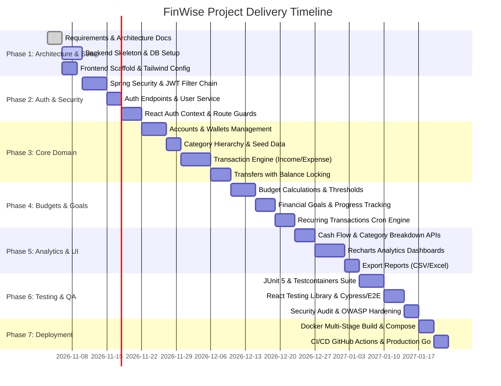

# FinWise - Smart Personal Finance Manager
## Project Implementation & Engineering Plan

---

### 1. Executive Summary & Vision

**FinWise** is an enterprise-grade, full-stack personal finance management application tailored for modern personal wealth tracking, budgeting, and financial goal attainment with native support for the Indian financial ecosystem (Indian Rupee - INR, Indian numbering format, and financial tax/calendar year conventions).

The system empowers individuals to aggregate multi-account balances, track detailed cash inflows and outflows, enforce category-level budget disciplines with real-time threshold notifications, visualize historical net worth trends, and project future savings with mathematical precision using Java 21's strict typing and `BigDecimal` computational accuracy.

---

### 2. Technology Stack & Decision Matrix

| Layer | Technology | Version | Rationale & Architectural Justification |
| :--- | :--- | :--- | :--- |
| **Runtime / Language** | Java (LTS) | 21 | Virtual Threads (Project Loom) for high-throughput I/O; Pattern Matching; Record types for immutable DTOs; strict type safety. |
| **Backend Framework** | Spring Boot | 3.3.x | Enterprise standard, production-ready observability (Actuator), Spring Security 6, Spring Data JPA 3, unified configuration. |
| **Build & Dependency** | Apache Maven | 3.9+ | Predictable build lifecycle, reproducible builds, robust multi-module plugin ecosystem, OWASP dependency checking. |
| **Database** | MySQL Server | 8.0+ | ACID compliance, transactional integrity (InnoDB), native JSON support for audit logs, strict decimal precision. |
| **Persistence / ORM**| Spring Data JPA / Hibernate | 6.x | Mature ORM, automated schema validation, dirty checking, optimistic locking (`@Version`), second-level caching support. |
| **Security & Auth** | Spring Security + JJWT | 6.x / 0.12.x | Stateless JWT authentication (access + refresh tokens with rotation), RBAC, BCrypt password hashing ($2a$12$). |
| **Frontend Framework** | React.js | 18.3+ | Component-driven architecture, robust ecosystem, concurrent rendering, virtual DOM diffing. |
| **Build Tool (Web)** | Vite | 5.x | Ultra-fast Hot Module Replacement (HMR), optimized Rollup-based production tree-shaking and asset bundling. |
| **Styling & UI** | Tailwind CSS | 3.4+ | Utility-first CSS, purge-based zero-runtime overhead, standardized design tokens, responsive breakpoints. |
| **Data Visualization** | Recharts | 2.12+ | Declarative SVG charting library built natively for React; seamless animations, tooltips, responsive containers. |
| **Icons & Assets** | Lucide React | Latest | Clean, consistent, lightweight SVG icon system. |
| **Client State** | TanStack Query v5 + Zustand | Latest | Server-state caching, automatic cache invalidation, minimal client-side global store. |
| **HTTP Client** | Axios | 1.7+ | Request/response interceptors for automatic JWT refresh tokens, global error handling. |
| **Containerization** | Docker & Compose | 26+ | Multi-stage slim container builds, isolated multi-service local and production parity. |

---

### 3. Work Breakdown Structure (WBS) & Milestones

#### Detailed Phase Breakdown

* **Phase 1: Foundations & Architecture Baseline (Week 1)**
  * Establish GitHub repository with branch protection rules (`main`, `develop`, feature branches).
  * Generate Maven project with Spring Boot 3.3.x, configure checkstyle and Spotless formatting rules.
  * Initialize Vite React SPA with Tailwind CSS, Lucide icons, and Axios configuration.
  * Establish MySQL schema migrations via Flyway / Spring JPA schema validation.

* **Phase 2: Authentication, Authorization & User Profile (Week 2)**
  * Implement `User`, `Role`, `RefreshToken` entities with BCrypt hashing (`$2a$12$`).
  * Construct stateless Spring Security filter chain with custom `JwtAuthenticationFilter` and entry points.
  * Implement user registration, login, refresh token rotation, and password reset flows.
  * Build React login, registration, and password recovery pages with form validation (Formik / React Hook Form + Zod).
  * Configure Axios interceptor for transparent 401 token refresh retry loops.

* **Phase 3: Financial Core — Accounts, Categories & Transactions (Weeks 3-4)**
  * Build `Account` service supporting bank accounts, credit cards, cash, and digital wallets with INR currency formatting.
  * Implement `Category` hierarchy (Income/Expense parent categories and subcategories) with system defaults and custom user categories.
  * Construct atomic `Transaction` engine supporting Income, Expense, and Account-to-Account Transfers.
  * Enforce strict transactional isolation (`@Transactional(isolation = Isolation.READ_COMMITTED)`) and optimistic locking on account balances.
  * Implement front-end UI for account management, transaction ledger, quick filters, and search.

* **Phase 4: Planning & Automation — Budgets, Goals & Recurring Schedules (Week 5)**
  * Create `Budget` module supporting monthly and custom periodic spend limits per category.
  * Build real-time budget utilization calculation with alert triggers (e.g., 80% warning, 100% exceeded).
  * Implement `Goal` tracking (e.g., Emergency Fund, House Down Payment) with automated contribution tracking.
  * Implement Spring `@Scheduled` worker for recurring subscriptions and bills (e.g., SIPs, Netflix, Rent) generating automated draft/posted transactions.

* **Phase 5: Financial Intelligence & Visualizations (Week 6)**
  * Develop analytics aggregation queries using Spring Data JPA projections and native MySQL queries for high performance.
  * Build interactive dashboard in React using Recharts:
    * Monthly Inflow vs Outflow bar charts.
    * Category expenditure donut charts.
    * Net worth progression area chart over 6, 12, and 24 months.
    * Budget burn-down gauges.
  * Implement CSV / Excel transaction export functionality.

* **Phase 6: Quality Assurance, Security Hardening & Benchmarking (Week 7)**
  * Unit test coverage > 85% with JUnit 5 and Mockito.
  * Integration tests with Testcontainers running real MySQL 8 container.
  * Test concurrent balance modifications for race conditions using `ExecutorService` and `CountDownLatch`.
  * OWASP Top 10 security audit: SQL injection, XSS, CSRF (stateless disabled with Secure SameSite cookies or Bearer headers), Rate Limiting with Bucket4j.

* **Phase 7: Packaging, CI/CD & Production Deployment (Week 8)**
  * Create multi-stage production Dockerfile for Spring Boot (using Eclipse Temurin 21 JRE Alpine image).
  * Create multi-stage Dockerfile for React SPA built with Vite and served via Nginx with Brotli/Gzip compression.
  * Setup Docker Compose with production environment profiles, database health checks, and restart policies.
  * Build GitHub Actions CI/CD pipeline for automated testing, Docker container build, and deployment.

---

### 4. Engineering Quality Gates & Principles

1. **Financial Arithmetic Integrity**:
   * **Rule**: Primitive `float` and `double` types are strictly banned in all financial entities, DTOs, calculations, and database mappings.
   * **Implementation**: All monetary values are represented as `java.math.BigDecimal` with scale 2 and `RoundingMode.HALF_EVEN` (Banker's Rounding) for standard transactions. Internal interest or split ratios are calculated to scale 4 before rounding.
2. **Stateless Scalability**:
   * No `HttpSession` data. Application state resides exclusively in the client (JWT) and MySQL database.
3. **Audit Trail Completeness**:
   * Every financial mutation records `created_at`, `updated_at`, `created_by`, `client_ip`, and optimistic lock `@Version`.
4. **Resilience & Fault Tolerance**:
   * All write operations on balances must execute inside atomic transactions. If a transfer fails to credit destination account, debit on source account must roll back completely.
5. **Separation of Concerns**:
   * Strict architectural separation: Controllers never communicate with Repositories directly. All domain rules reside in Service layers; business validations occur before persistence.

---

### 5. Risk Assessment & Mitigation Matrix

| Risk Factor | Impact | Likelihood | Mitigation Strategy |
| :--- | :--- | :--- | :--- |
| **Floating-Point Precision Drift** | High | Low (with safeguards) | Automated ArchUnit test scanning codebase to fail builds if `float` or `double` is declared in financial packages. |
| **Concurrent Balance Overdraw / Race Conditions** | Critical | Medium | Optimistic locking (`@Version` on `Account`), explicit database row-locking where necessary (`PESSIMISTIC_WRITE`), and DB-level `CHECK (balance >= credit_limit)` constraints. |
| **JWT Token Hijacking** | High | Low | Short-lived access tokens (15 minutes), refresh tokens stored as secure HTTP-only cookies, token family rotation with automatic revocation upon reuse detection. |
| **High Latency on Analytics Aggregations** | Medium | Medium | Composite indexes on `(user_id, transaction_date, category_id)`, pre-aggregated monthly summary tables, and Spring Cache abstraction (Redis or Caffeine). |
| **Indian Number Formatting Discrepancies** | Low | Low | Unified frontend utility `formatINR(amount)` implementing standard Indian numbering grouping (`12,34,567.89`) and ISO-4217 symbol `₹`. |

---

### 6. Deliverables Sign-off Criteria

* [x] **Architecture Specification** (`ARCHITECTURE.md`): Component models, package layouts, security mechanisms, concurrency controls.
* [x] **Database Schema & Entity Models** (`DATABASE_DESIGN.md`): Full ER diagram, DDL scripts, constraints, indexing plan, and seed data.
* [x] **REST API Blueprint** (`API_DESIGN.md`): RFC 7807 compliance, detailed endpoint contracts, JSON schemas, rate-limiting, and error formats.
* [x] **Implementation Roadmap** (`PROJECT_PLAN.md`): Milestone breakdown, WBS, engineering quality standards.
