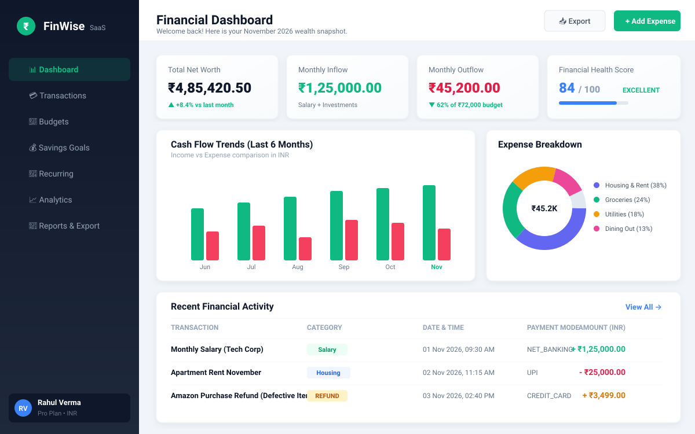
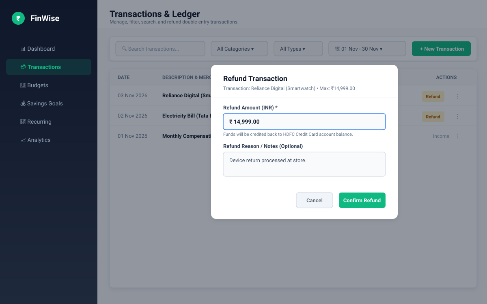
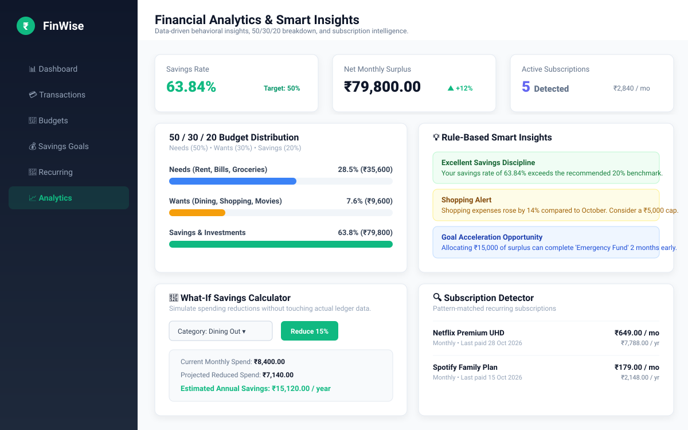
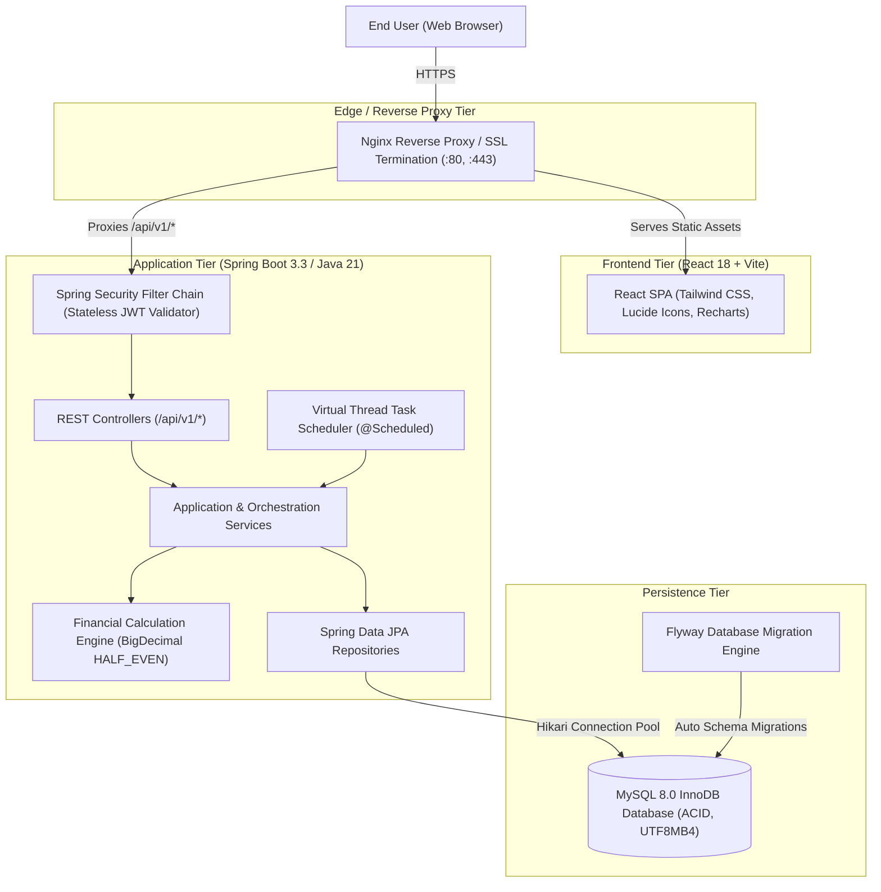
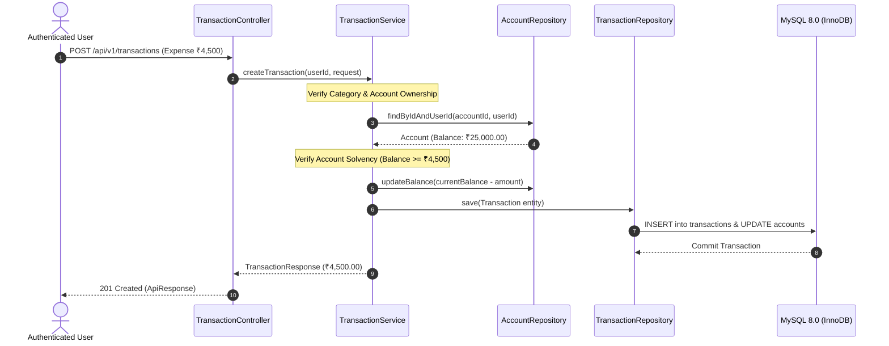

# FinWise — Smart Personal Finance Manager

[](https://openjdk.org/projects/jdk/21/)
[](https://spring.io/projects/spring-boot)
[](https://react.dev/)
[](https://tailwindcss.com/)
[](https://www.mysql.com/)
[](https://www.docker.com/)
[](https://junit.org/junit5/)
[](https://owasp.org/)
[](LICENSE)

> **FinWise** is an enterprise-grade, full-stack personal finance and wealth management platform engineered with mathematical rigor for the Indian financial ecosystem. It combines an immutable double-entry transaction ledger, real-time category budget alerts, savings milestones, predictive subscription detection, and automated PDF/CSV exports with native Indian Rupee (`₹` / `INR`) formatting and Banker's Rounding accuracy.

---

## 📸 Application Screenshots

### 1. Executive Financial Dashboard
Real-time net worth tracking, paired cash-flow trends, spending breakdown donut, and educational financial health scoring.



---

### 2. Double-Entry Transactions Ledger & Refund Modal
Comprehensive ledger management featuring search, date and category filtering, Indian numbering formatting (`₹1,25,000.00`), and safe partial/full expense refunds.



---

### 3. Financial Analytics & Smart Insights
Behavioral financial diagnostics including the 50/30/20 Needs vs Wants breakdown, rule-based smart recommendations, AI subscription detection, and what-if simulation.



---

## 🏛️ System Architecture

FinWise is architected with a strict separation between presentation, application orchestration, domain calculation invariants, and database persistence.



### Double-Entry Financial Mutation Flow


---

## 🌟 Key Features

- **Double-Entry Transfers & Solvency-Checked Reversals**:
  Atomically debits source account, credits destination account, and calculates transfer fees. Transfers can be reversed via `DELETE /api/v1/transfers/{id}` with destination account solvency protection.
- **First-Class Expense Refunds**:
  Full and partial expense refunds (`POST /api/v1/transactions/{id}/refund`) with cumulative cap validation (`<= original.amount`) that credits account balances while retaining an audit trail.
- **Enterprise Monetary Precision**:
  Zero floating-point inaccuracies. All monetary values leverage `BigDecimal` with Banker's rounding (`RoundingMode.HALF_EVEN`) and `DECIMAL(15, 2)` database columns.
- **Indian Financial Ecosystem Support**:
  Native Indian Rupee currency symbol (`₹`), ISO code (`INR`), and Indian numbering system format (`₹1,25,000.00` - Hundreds, Thousands, Lakhs, Crores).
- **Stateless JWT Security Architecture**:
  Short-lived Access Tokens (15 min) paired with cryptographically secure Refresh Tokens (7 days). Session revocation invalidates all tokens upon password changes.
- **Strict Cross-User Isolation**:
  Multi-tenant security policies guarantee users can never view, mutate, or link accounts, categories, budgets, or transactions owned by other users.
- **Rule-Based Smart Insights & 50/30/20 Analytics**:
  Automated breakdown of spending across Needs (50%), Wants (30%), and Savings (20%), plus month-over-month trend analysis.
- **Pattern-Matching Subscription Detector**:
  Identifies recurring subscription expenses (Netflix, Spotify, Internet, Gym) from historical transaction patterns.
- **What-If Savings Simulator**:
  Enables users to project annual and monthly savings from hypothetical spending cuts without mutating actual ledger records.
- **Financial Reports & Exports**:
  Generate monthly, annual, and category reports downloadable as formatted PDF (INR) or RFC-4180 compliant CSV.
- **System Observability & Health Probes**:
  Provides `/api/v1/health` and Spring Boot Actuator `/actuator/health` with Kubernetes/Docker liveness and readiness probes.

---

## 🛠️ Technology Stack Matrix

| Layer | Component | Version | Purpose |
| :--- | :--- | :--- | :--- |
| **Backend Runtime** | Java OpenJDK (LTS) | **21** | Modern Java virtual threads, records, pattern matching |
| **Framework** | Spring Boot | **3.3.5** | Dependency injection, security, MVC, scheduling |
| **Database** | MySQL Server | **8.0** | ACID compliance, transactional InnoDB engine |
| **ORM / Persistence** | Spring Data JPA / Hibernate | **6.5** | Type-safe queries, optimistic concurrency |
| **Database Migrations** | Flyway | **10.x** | Automated, version-controlled SQL migrations |
| **Security & Auth** | Spring Security + JJWT | **6.1 / 0.12** | Stateless Bearer authentication, BCrypt ($2a$12$) |
| **Frontend Framework** | React + TypeScript | **18.3 / 5.6** | Single Page Application, strict type safety |
| **Bundler & Dev Server** | Vite | **5.4** | Ultra-fast HMR and optimized production bundling |
| **Styling & Design** | Tailwind CSS | **3.4** | Responsive fintech SaaS design system |
| **Visualizations** | Recharts | **2.13** | Interactive cash-flow bar charts & spending donuts |
| **Web Server / Proxy** | Nginx Alpine | **1.27** | Production static file serving, reverse proxy, SSL |
| **Testing** | JUnit 5 + MockMvc + AssertJ | **5.10** | 105 automated unit, integration, and security tests |

---

## 🚀 Quickstart with Docker Compose (Recommended)

Run the entire application stack (MySQL, Spring Boot Backend, and React Frontend) with a single command:

### Step 1: Clone Repository & Create Environment Configuration
```bash
git clone https://github.com/your-username/FinWise.git
cd FinWise

# Copy environment template
cp .env.example .env
```
*(On Windows PowerShell: `Copy-Item .env.example .env`)*

### Step 2: Build & Start All Containers
```bash
docker compose up -d --build
```

### Step 3: Access FinWise
Once the containers report healthy (`docker compose ps`):
- **Web Application**: [http://localhost](http://localhost)
- **REST API Base**: [http://localhost:8080/api/v1](http://localhost:8080/api/v1)
- **Health Endpoint**: [http://localhost:8080/api/v1/health](http://localhost:8080/api/v1/health)

---

## 💻 Manual Local Development Setup

### 1. Backend Setup
1. Ensure **MySQL 8.0** is running on `localhost:3306` with database `finwise_db`.
2. Run backend with Maven:
   ```bash
   # On Linux / macOS
   ./mvnw spring-boot:run

   # On Windows
   tools\maven\bin\mvn.cmd spring-boot:run
   ```
   *Flyway automatically creates the database schema and seeds default categories.*

### 2. Frontend Setup
In a new terminal:
```bash
cd frontend
npm install
npm run dev
```
Open [http://localhost:5173](http://localhost:5173). Calls to `/api/*` automatically proxy to `http://localhost:8080`.

---

## 🧪 Testing & Verification

Execute the complete 105-test suite covering authentication, cross-user isolation, mathematical precision, transfers, refunds, and exports:

```bash
# Run all backend unit, integration, and security tests
mvn test

# Run frontend TypeScript type-checking and production build
cd frontend && npm run build
```

**Verification Results:**
```
[INFO] Tests run: 105, Failures: 0, Errors: 0, Skipped: 0
[INFO] BUILD SUCCESS
```

---

## 🔒 Security & Quality Standards

- **Zero Plaintext Credentials**: All secrets, passwords, and JWT signing keys are injected via environment variables.
- **BCrypt Encryption**: Passwords hashed with BCrypt at work factor 12. Password hashes are never serialized in DTOs.
- **SQL Injection Defense**: 100% parameterized queries via Spring Data JPA criteria and JPQL.
- **Rate-Limiting & Strict CORS**: Configurable allowed origins with credentials support.
- **Banker's Rounding**: Strict `BigDecimal` arithmetic using `RoundingMode.HALF_EVEN` at scale 2 to eliminate statistical rounding bias.

---

## 📚 Documentation & Guides

- [**`API_DOCUMENTATION.md`**](API_DOCUMENTATION.md) — Comprehensive REST API endpoint reference and payloads.
- [**`SETUP.md`**](SETUP.md) — Detailed deployment, cloud provisioning, and developer guides.
- [**`DATABASE_BACKUP_GUIDE.md`**](DATABASE_BACKUP_GUIDE.md) — Automated database backup, S3 replication, and disaster recovery.
- [**`ARCHITECTURE.md`**](ARCHITECTURE.md) — High-level architectural specifications and design decisions.

---

## 📄 License

This project is licensed under the MIT License — see the [LICENSE](LICENSE) file for details.
